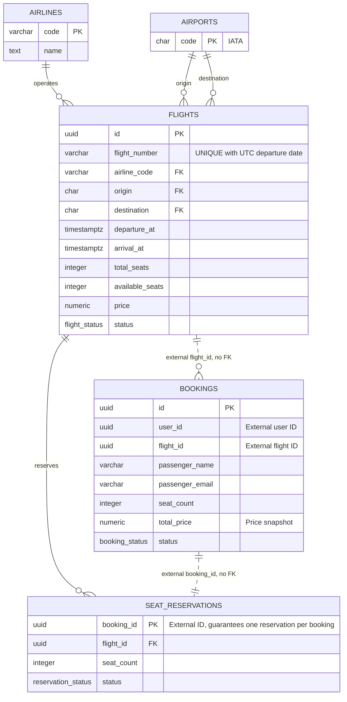

# Flight Booking — ДЗ №3

Два сервиса: `REST → Booking → gRPC → Flight`. У каждого своя PostgreSQL. Redis: мастер, реплика и три Sentinel (quorum 2). Единственный внешний порт — REST `localhost:8000`.

## Запуск и демонстрация

```sh
docker compose up --build -d --wait
curl http://localhost:8000/health
docker compose exec booking python demo.py
```

[Swagger](http://localhost:8000/docs). Демо проверяет поиск, бронирование, цену, отмену, недостаток мест, gRPC-аутентификацию, повторное резервирование и обновление кеша. В БД есть три учебных рейса; основной: `00000000-0000-0000-0000-000000000001`, SVO → LED, **2030-01-10**, цена 4500 RUB, 10 мест.

Остановка: `docker compose down`. Данные сохраняются. Для другого REST-порта: `API_PORT=8001 docker compose up --build -d --wait`.

## Контракты

| REST Booking | Действие |
|---|---|
| `GET /flights?origin=SVO&destination=LED&date=2030-01-10` | Поиск SCHEDULED, дата необязательна |
| `GET /flights/{id}` | Информация о рейсе |
| `POST /bookings` | Создать бронирование |
| `GET /bookings/{id}` | Получить бронирование |
| `GET /bookings?user_id=UUID` | Бронирования пользователя |
| `POST /bookings/{id}/cancel` | Отменить CONFIRMED |

Тело создания:

```json
{"user_id":"10000000-0000-0000-0000-000000000001","flight_id":"00000000-0000-0000-0000-000000000001","passenger_name":"Demo Passenger","passenger_email":"demo@example.com","seat_count":2}
```

`flight.proto` задаёт SearchFlights, GetFlight, ReserveSeats, ReleaseReservation и UpdateFlight. Даты — protobuf Timestamp, статусы — enum, цена — точная десятичная строка в рублях. REST возвращает total_price как JSON-число. Все даты и уникальность номера рейса по дню определены в UTC.

Код генерируется **protoc на каждой сборке**; `*_pb2.py` и `*_pb2_grpc.py` исключены из Git и Docker-контекста. Повторная генерация внутри контейнера:

```sh
docker compose exec -u 0 booking python -m grpc_tools.protoc -I. --python_out=. --grpc_python_out=. flight.proto
```

Все gRPC-методы требуют `x-api-key` в metadata. Ключ берётся из `GRPC_API_KEY`; неверный ключ → UNAUTHENTICATED. REST-аутентификация пользователей в этом задании не реализуется.

| gRPC-ошибка | Причина | REST |
|---|---|---|
| INVALID_ARGUMENT | Неверные UUID, маршрут, дата, цена, количество | 400 |
| NOT_FOUND | Рейс отсутствует | 404 |
| RESOURCE_EXHAUSTED | Недостаточно мест | 409 |
| FAILED_PRECONDITION | Рейс не SCHEDULED или резерв уже освобождён | 409 |
| ALREADY_EXISTS | Повтор booking_id с другими параметрами | 409 |
| UNAUTHENTICATED | Неверный межсервисный ключ | 502 |
| UNAVAILABLE / DEADLINE_EXCEEDED | Сбой зависимости, таймаут, открытый circuit | 503 |

Неверное тело REST-запроса → 422. Бронирование не найдено → 404; повторная отмена → 409.

## Как устроен код

- `booking.py` — REST, снимок цены, локальные транзакции и восстановление незавершённых операций.
- `flight.py` — gRPC-сервер, проверка ключа, места, Cache-Aside и инвалидация.
- `rpc.py` — клиентский interceptor: ключ, deadline, retry и circuit breaker. Бизнес-функции эти механизмы не дублируют.
- `db.py` — соединение только со своей БД и advisory lock по booking_id.
- `migrations/` — две независимые схемы, автоматически применяемые Flyway до запуска сервисов.
- `demo.py` — короткая проверка всей цепочки.
- `Dockerfile`, `docker-compose.yml`, `sentinel.conf` — сборка и инфраструктура.

## Транзакции и отказы

Flight блокирует рейс через **SELECT FOR UPDATE**. Проверка остатка, уменьшение available_seats и создание резерва — одна транзакция. Возврат мест и RELEASED — тоже одна транзакция. booking_id — первичный ключ резерва: повтор с теми же параметрами возвращает существующий результат, повтор с другими параметрами запрещён. Освобождение резерва идемпотентно.

Booking выполняет **GetFlight → ReserveSeats → INSERT Booking** и сохраняет total_price как снимок `seat_count × price`. Изменение цены рейса не меняет старые бронирования. Если ReserveSeats завершается ошибкой, Booking не создаётся.

Общей транзакции двух БД нет. До вызовов Booking сохраняет ID в журнал `operations`. При ошибке возвращает резерв; если Flight недоступен или Booking аварийно завершился, фоновое восстановление повторяет отмену. Запись журнала удаляется в той же локальной транзакции, что и подтверждение/отмена Booking. Session advisory lock не даёт восстановлению отменить ещё выполняющийся запрос.

При сетевом отказе допускается временный незавершённый резерв; после восстановления он компенсируется. `cancelled_requests` во Flight защищает от позднего ReserveSeats, который пришёл уже после компенсации. Это компактная saga с долговечным журналом; она не выдаётся за атомарную транзакцию между двумя БД.

## Redis и устойчивость gRPC

Cache-Aside: ключ → при miss PostgreSQL → запись с **TTL 300 секунд**. Ключи: `flight:{id}:{version}` и `search:{origin}:{destination}:{date|any}:{version}`. В логах видны hit/miss. Мутации обновляют версию в той же PostgreSQL-транзакции, затем удаляют кеш. Версия защищает от старых значений после конкурентного чтения или переключения Redis. Цена этого решения — небольшой запрос версии в БД даже при cache hit; кеш экономит чтение полных данных и JOIN. При недоступности кеша читается PostgreSQL.

Клиент использует **redis.sentinel.Sentinel.master_for**. Три Sentinel выбирают новый мастер при отказе текущего. Репликация асинхронная: потеря последних записей кеша допустима, PostgreSQL остаётся источником истины.

На одну операцию открывается gRPC-канал и затем закрывается; политика retry/breaker общая. Это исключает использование зависшего TCP-соединения после перезапуска контейнера, ценой дополнительного подключения на запрос.

Retry — максимум **3 попытки**, паузы **100 и 200 мс**, только UNAVAILABLE и DEADLINE_EXCEEDED. Встроенные автоматические retry gRPC отключены. Стабильный booking_id защищает ReserveSeats от повторного списания.

Circuit breaker общий для вызовов клиента: CLOSED → OPEN после порога последовательных неуспехов в окне; OPEN сразу возвращает 503; после таймаута HALF_OPEN пропускает **один** пробный RPC без retry. Успех закрывает circuit, повторный сбой открывает его. Переходы логируются.

| Переменная | По умолчанию |
|---|---|
| `GRPC_TIMEOUT` | 1 секунда на попытку |
| `CB_FAILURE_THRESHOLD` | 5 неуспешных вызовов после retry |
| `CB_RESET_SECONDS` | 10 секунд до пробного вызова |
| `CB_WINDOW_SECONDS` | 60 секунд |

`GRPC_API_KEY` и `DB_PASSWORD` задаются окружением; значения по умолчанию в Compose — локальные учебные.

## Показать на защите

```sh
# Данные разных сервисов — в разных БД:
docker compose exec flight-db psql -U app -d app -c 'SELECT id,available_seats FROM flights;'
docker compose exec flight-db psql -U app -d app -c 'SELECT * FROM seat_reservations;'
docker compose exec booking-db psql -U app -d app -c 'SELECT * FROM bookings;'
# Кеш и переходы breaker:
docker compose logs flight booking
# Остановка Flight: повторные запросы REST дают 503 и открывают circuit.
docker compose stop flight
docker compose start flight
# Через 10 секунд следующий вызов пробует восстановить соединение.
# Узнать текущий мастер Redis:
docker compose exec sentinel-1 redis-cli -p 26379 SENTINEL get-master-addr-by-name flights
```

Для failover остановите сервис, который Sentinel показал мастером (`redis-master` либо `redis-replica`), повторите поиск и запрос адреса мастера. Затем верните сервис через `docker compose start <имя>` — Sentinel подключит его как реплику.

## Проверено 3 ноября 2026

Пройдены: E2E, все gRPC-методы без/с неверным ключом, гонка за последнее место, повторные резервы и отмены, снимок цены, ошибки БД с компенсацией, падение и восстановление Booking, TTL/инвалидация кеша, точное число retry, реальные переходы circuit breaker, переключение Redis на реплику и возврат бывшего мастера. В итоговой конфигурации все постоянные контейнеры healthy; Flyway завершился с кодом 0.

## ER и 3NF

Flight DB: airlines, airports, flights, seat_reservations. Booking DB: bookings. Между БД **нет FK и прямых SQL-запросов**: пунктир обозначает только логическую связь. Название авиакомпании хранится один раз; атрибуты рейса и резерва зависят от их ключей. В Booking данные пассажира относятся к конкретному бронированию, а total_price — историческая цена, не текущая цена рейса. Это не создаёт зависимости flight_id → total_price.

Технические таблицы: `operations` — журнал Booking; `cancelled_requests` — барьер отменённых ID Flight; `cache_version` — поколение кеша Flight. Они не меняют бизнес-модель.


