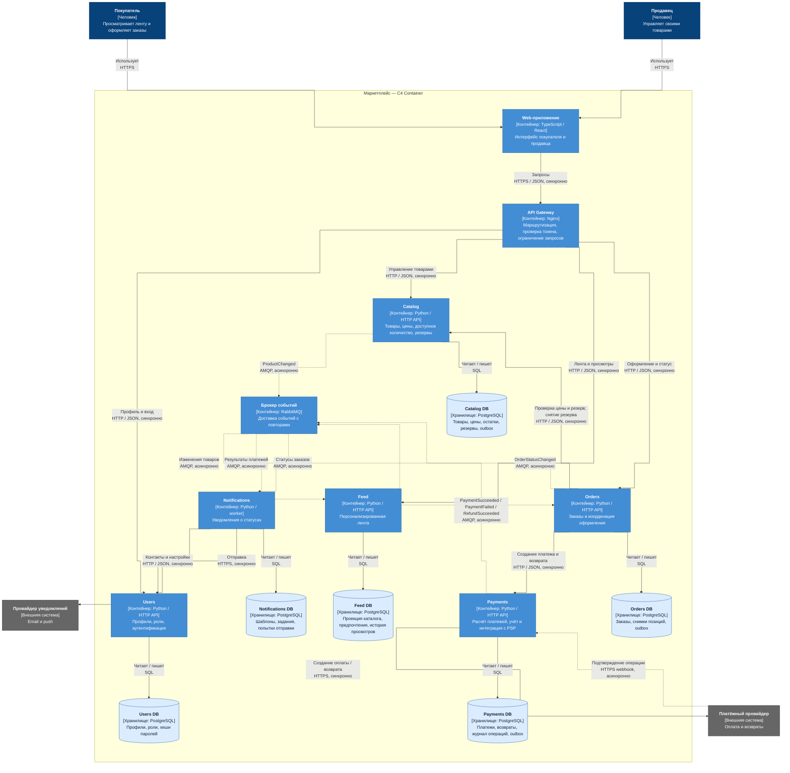

# Архитектура маркетплейса

Учебный проект: архитектура и каркас Catalog. Реализован только `GET /health`, остальные домены описаны как проект. Бизнес-логики, баз данных и брокера в запускаемом приложении нет.

## 1. Требования и границы

Покупатели смотрят персональную ленту и оформляют заказы; продавцы ведут каталог. Система управляет пользователями, рассчитывает и учитывает платежи, сообщает о статусах заказов. Доставку товаров и интеграции с логистикой в этот этап не включаем.

Персонализация простая: категории из последних просмотров получают больший вес, внутри категории товары сортируются по популярности. Для нового пользователя — популярные товары. Feed хранит свою проекцию опубликованных товаров и историю просмотров; цены и наличие при оформлении проверяются в Catalog. ML-платформа для этого не нужна.

## 2. C4 Container

Диаграмма показывает людей, внешние системы, границу маркетплейса, приложения и отдельные хранилища. У контейнеров указаны назначение и технология; у связей — протокол и характер взаимодействия. C4-контейнер означает приложение или хранилище, а не обязательно Docker-контейнер.

Исходник: [docs/containers.mmd](docs/containers.mmd). Связи имеют прямоугольные повороты; пунктир обозначает асинхронные взаимодействия. Ниже та же схема в Mermaid; её отображают GitHub и совместимые Markdown-просмотрщики.



## 3. Домены, сервисы и данные

| Домен → сервис | Ответственность | Собственные данные |
|---|---|---|
| Пользователи → Users | Вход, профили покупателей и продавцов, роли, настройки контактов | Users DB: профили, контакты, роли, хеши паролей |
| Каталог → Catalog | Товары продавцов, категории, цены, доступное количество и резервы | Catalog DB: карточки, цены, остатки, резервы |
| Персонализация → Feed | Сбор просмотров, ранжирование и выдача ленты | Feed DB: просмотры, предпочтения, популярность, проекция каталога |
| Заказы → Orders | Создание заказа, жизненный цикл, координация резерва и оплаты | Orders DB: заказы, снимки позиций и цен, состояние оформления |
| Платежи → Payments | Расчёт суммы платёжной операции по снимку заказа, оплата, возвраты, учёт | Payments DB: платежи, валюта и суммы, внешние ID, журнал операций |
| Уведомления → Notifications | Шаблоны, задания, повторы отправки | Notifications DB: задания, шаблоны, история доставки |

Gateway и Web — технические контейнеры, доменными данными не владеют. Брокер хранит сообщения до обработки и не заменяет базы сервисов.

У каждого сервиса отдельная база и отдельные учётные данные. Чужую базу читать нельзя: только API или события. Проекция Catalog в Feed и снимок товара в Orders — локальные копии с определённой целью, источником истины по товару остаётся Catalog. Orders владеет исторической ценой оформленного заказа. Payments не хранит реквизиты карт: они остаются у платёжного провайдера.

Разбиение соответствует разным причинам изменений: каталог меняется из-за правил продавцов, лента — из-за ранжирования, платежи — из-за финансового учёта и провайдера. Feed можно масштабировать под чтение независимо, Notifications — под очередь отправки. Orders координирует процесс, но не забирает владение товарами и платежами.

## 4. Взаимодействия и согласованность

| Кто → кому | Зачем | Способ |
|---|---|---|
| Web → Gateway → Users / Catalog / Feed / Orders | Вход, товары, лента, заказ | Синхронный HTTPS снаружи, HTTP/JSON внутри |
| Orders → Catalog | Проверить актуальную цену, зарезервировать или освободить количество | Синхронный HTTP/JSON |
| Orders → Payments → платёжный провайдер | Создать платёж или возврат | Синхронный API; создание платежа ещё не подтверждает оплату |
| Провайдер → Payments | Подтвердить результат операции | Асинхронный HTTPS webhook |
| Catalog → брокер → Feed | Обновить проекцию товаров | Асинхронный ProductChanged |
| Payments → брокер → Orders | Обновить состояние после оплаты или возврата | Асинхронные события результата операции |
| Orders → брокер → Notifications | Сообщить о смене статуса | Асинхронный OrderStatusChanged |
| Notifications → Users | Получить актуальные контакты и настройки | Синхронный HTTP/JSON |
| Notifications → провайдер уведомлений | Отправить email/push | Синхронный HTTPS API, повторы через задания |

Сценарий оформления: Orders получает от Catalog цену и резерв, сохраняет снимок заказа, затем запрашивает Payments. Payments рассчитывает сумму по этому снимку в минимальных единицах валюты и возвращает ссылку на оплату. Заказ становится оплаченным только после проверенного webhook и события PaymentSucceeded. Доставка уведомления не блокирует оформление.

Общей транзакции между сервисами нет. Orders ведёт saga: при отказе оплаты или истечении срока снимает резерв; если деньги уже списаны и заказ завершить нельзя, инициирует возврат. При таймауте состояние сначала уточняется повтором с тем же ключом идемпотентности. Поздняя оплата после отмены требует возврата, а не восстановления заказа без резерва.

План надёжности: transactional outbox у издателей, доставка событий минимум один раз, дедупликация по event_id у получателей. Версия объекта защищает проекцию от старых событий. Ошибки обрабатываются ограниченными повторами и dead-letter queue. Лента и уведомления согласуются с задержкой, резерв и цена подтверждаются синхронно. Эти механизмы здесь описаны, но не реализованы.

## 5. Два варианта декомпозиции

| Вариант | Плюсы | Минусы |
|---|---|---|
| **A. Модульный монолит:** одно backend-приложение, шесть модулей и одна PostgreSQL | Один деплой; проще отладка; заказ и резерв могут меняться в одной транзакции; меньше инфраструктуры | Нельзя отдельно масштабировать ленту; ошибка или релиз backend затрагивает все домены; границы модулей приходится контролировать внутри кода |
| **B. Шесть сервисов:** Users, Catalog, Feed, Orders, Payments, Notifications, отдельные базы и брокер | Явное владение данными; независимое масштабирование и релизы; сбой отправки уведомлений не останавливает заказ | Больше деплоев и мониторинга; сетевые отказы; нет общей транзакции; нужны saga, outbox, дедупликация и согласование контрактов |

**Выбран вариант B.** В кейсе есть разные профили нагрузки: лента часто читается, каталог изменяют продавцы, платежи требуют отдельного учёта, уведомления допускают задержку. Поэтому выделяем эти границы явно. Для маленькой команды с небольшим трафиком вариант A дешевле; выбор B в этой работе нужен для проектирования независимых сервисов, а не потому, что монолит всегда хуже. Ограничение этапа соблюдено: запускаем только пустой Catalog, инфраструктуру остальных доменов не имитируем.

## 6. Зафиксированные решения

- **Отдельные базы:** границы ответственности проверяемы; цена — отказ от межсервисных SQL JOIN и общих транзакций.
- **HTTP для немедленного ответа, события для последствий:** цену и резерв нужно подтвердить до оплаты, лента и уведомления могут обновиться позже.
- **Простая персонализация:** покрывает требование без отдельной ML-инфраструктуры; качество рекомендаций ниже, чем у обучаемой модели.
- **Платёжный провайдер снаружи:** не храним карточные данные; зависим от доступности и контрактов провайдера.
- **Python standard library для каркаса:** нет сторонних зависимостей; достаточно для health-check. Это не выбор полноценного production HTTP-сервера.

В целевой системе Gateway проверяет токены, а сервисы дополнительно проверяют права: продавец может менять только свои товары. Webhook проверяется по подписи провайдера, ключи хранятся вне репозитория. Для диагностики понадобятся request_id, метрики задержек и ошибок, длина очередей и трассировка оформления.

## 7. Запуск

Нужны Docker Engine / Docker Desktop и Docker Compose v2. Из корня репозитория:

```sh
docker compose up --build -d --wait
docker compose ps
curl -i http://localhost:8000/health
```

Ожидаемый HTTP-статус: `200 OK`. Тело:

```json
{"status": "ok"}
```

Compose запускает только Catalog на порту 8000. В Dockerfile есть health-check; процесс работает без root. Если порт занят, измените левую часть `127.0.0.1:8000:8000` и адрес в curl.

Остановка:

```sh
docker compose down
```

Без Docker, для локальной проверки (Python 3.12+):

```sh
python3 service/main.py
# В другом терминале:
curl -i http://localhost:8000/health
```

Автоматическая проверка HTTP-контракта и отсутствия товарного endpoint:

```sh
python3 -m unittest discover -s tests -v
```

## 8. Что проверено

Локальные HTTP-тесты проверяют `200`, JSON и `404` для `/products`. Результат проверки записан в [docs/verification.md](docs/verification.md). Docker-сборку необходимо подтвердить на машине с Docker: наличие Dockerfile само по себе не доказывает запуск контейнера.

## 9. Сдача

В репозитории должны остаться README, docs, service, tests, Dockerfile, docker-compose.yml и dotfiles. Создайте пустой репозиторий GitHub/GitLab, затем выполните в этой папке:

```sh
git init
git add .
git commit -m "Add marketplace architecture and health service"
git branch -M main
git remote add origin <URL-ВАШЕГО-РЕПОЗИТОРИЯ>
git push -u origin main
```

Перед сдачей выполните Docker-команды из раздела 7 и приложите ссылку на репозиторий.
