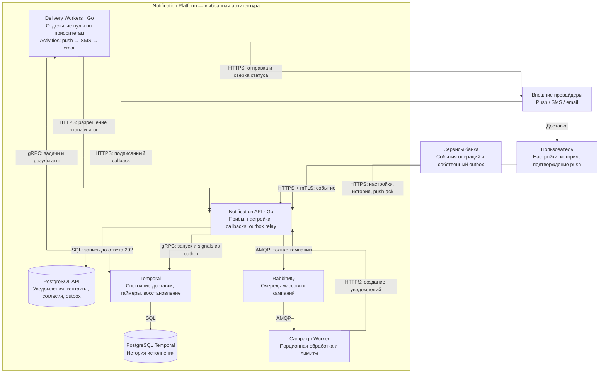

# RFC: гарантированная доставка критичных уведомлений

Статус: предложение. Дата: 17.11.2026. Область: Notification Platform онлайн-банка.

## 1. Цели

Бизнес-цели: увеличить D30 retention на 15% относительно контрольной группы и снизить число жалоб на 1000 доставленных уведомлений на 30%. Это гипотезы продукта, а не гарантированный результат архитектуры. Проверяем через восьминедельный A/B-тест маркетинговых и сервисных сценариев; критичные сообщения доставляем одинаково в обеих группах. Сравниваем сопоставимые когорты, учитываем сезонность и заранее рассчитываем размер выборки.

## 2. Функциональные требования

| ID | Поведение системы | Связь с целью |
|---|---|---|
| F1 | Команды банка передают уведомления через единую платформу и видят их статус. | Централизованный контроль и меньше жалоб. |
| F2 | Подтверждения операций и предупреждения безопасности нельзя отключить. Если основной канал недоступен, используется резервный. | Безопасность и доставка критичных сообщений. |
| F3 | Пользователь выбирает предпочтительный канал, отключает маркетинг и необязательные сервисные сообщения, задаёт тихие часы. Критичные сообщения обходят тихие часы. | Меньше раздражения и жалоб. |
| F4 | В истории пользователя сохраняется одно уведомление об одном событии, даже если отправитель повторил запрос. | Меньше дублей и понятная история. |
| F5 | Банк запускает кампанию до 1 млн получателей, с лимитом пять маркетинговых сообщений на человека в день. Перед отправкой повторно проверяются согласия. | Retention без спама. |
| F6 | При сбоях платформа продолжает попытки доставки критичного сообщения и передаёт неразрешённый случай оператору. | Критичные сообщения не теряются молча. |
| F7 | Подтверждённая доставка прекращает последующие попытки; пользователь может посмотреть историю в приложении. | Меньше повторов и жалоб. |
| F8 | При соблюдении срока доставки выбирается наиболее дешёвый доступный канал. | Контроль расходов банка. |

Обязательность F2 должна быть согласована с юридической службой. Пользователь выбирает предпочтение, но не может запретить все резервные каналы для обязательного сообщения.

## 3. Нефункциональные требования

Все показатели ниже — проектные цели, которые предстоит проверить. Месячные SLO считаются отдельно для критичного трафика.

| ID | Измеримое требование |
|---|---|
| N1 | Приём запроса: p99 ≤ 200 мс, доступность API ≥ 99,95% в месяц. Ответ об успехе — только после устойчивой записи. |
| N2 | От записи в платформе до первой попытки у провайдера: p99 ≤ 2 с. Подтверждение доставки критичного сообщения хотя бы одним внешним каналом: ≥ 99,9% за 60 с при наличии хотя бы одного исправного канала и действительного адреса. |
| N3 | Выдерживать 4000 новых уведомлений/с и 12 000 попыток/с в течение 15 минут без нарушения N2. Кампания на 1 млн получателей должна завершать первичные попытки ≤ 30 минут. |
| N4 | RPO = 0 для принятых сообщений при потере одного узла или одной зоны доступности; RTO ≤ 60 с. Катастрофа всего региона: RPO ≤ 5 минут, RTO ≤ 1 часа. |
| N5 | Один логический объект на `(producer_id, event_id, recipient_id, type)`; повторов внешней доставки из-за failover ≤ 0,1% критичных сообщений за месяц. Все выявленные повторы расследуются. |
| N6 | В 100% попыток есть notification_id, канал, номер попытки, время и исход; алерт при oldest_pending > 60 с появляется ≤ 1 минуты после превышения. |
| N7 | TLS между компонентами, шифрование хранилищ, доступ только по роли. Тела сообщений хранятся 30 дней, обезличенные технические статусы — 1 год. Очистка просроченных тел ≤ 24 ч. |
| N8 | В нормальном режиме SMS используется не более чем для 10% критичных сообщений в сутки. Превышение вызывает алерт, но бюджет не блокирует обязательную доставку. |

Доставка означает подтверждение приложением для push, оператором для SMS или принимающим почтовым сервером для email. Это разные по силе свидетельства, ни одно не доказывает прочтение человеком. HTTP 200/202 от провайдера означает только приём заявки. Каналы без проверяемого статуса не считаются подтверждённой доставкой.

## 4. ASR и архитектурные последствия

P0 — обязательное условие; P1 — важная оптимизация. При конфликте: сохранность → доставка → отсутствие повторов → стоимость.

| ASR | Приоритет, требования | Почему влияет и какие последствия |
|---|---|---|
| A1. Критичный трафик не ждёт маркетинг | P0; F2, F5, N2, N3 | Отдельные очереди/пулы и квоты провайдеров; независимое масштабирование; отдельные лимиты соединений к БД. При перегрузке маркетинг приостанавливается. |
| A2. Восстановление без тихой потери | P0; F2, F6, N1, N4 | Устойчивая запись до ответа, outbox, долговечные таймеры, репликация по трём зонам, автоматическое восстановление незавершённых процессов. |
| A3. Failover с контролем дублей | P0; F4, F7, N5 | Единый координатор сообщения, идемпотентные команды и callbacks, журнал попыток, состояние UNKNOWN, сверка статуса перед повтором. Exactly-once у пользователя недостижим при произвольных внешних провайдерах. |
| A4. Настройки и стоимость | P1; F3, F8, N7, N8 | Версионированная политика каналов, повторная проверка согласий, дешёвый канал первым при допустимой задержке, аудит обхода предпочтений. |
| A5. Наблюдаемость и защита данных | P0; F1, F6, N6, N7 | Сквозной ID, метрики задержек и исходов, отдельный аудит, подписанные callbacks, ограниченное хранение и маскирование. |

## 5. Архитектурные вопросы

| Вопрос | Основание | Почему важен / ответ RFC |
|---|---|---|
| Когда считать сообщение доставленным? | A2, A3; F2, N2 | Приём провайдером не равен доставке. Используем подтверждение канала, иначе ждём или переключаемся. |
| Где хранить состояние и таймеры failover? | A2; N4 | Таймер в памяти пропадёт при рестарте. Сравниваем SQL-автомат и Temporal. |
| Как изолировать кампанию от подтверждения перевода? | A1; N2, N3 | Общая FIFO-очередь задержит критичные сообщения. Нужны раздельные ресурсы и приоритетные квоты. |
| Что делать после timeout провайдера? | A3; N5 | Результат неизвестен. Сначала сверяем статус; после ограниченного ожидания выбираем доставку с риском дубля. |
| Когда допустим дорогой SMS? | A4; F2, F8, N8 | При отсутствии подтверждения дешёвого канала, недоступности предпочтительного или его несоответствии сроку. |

## 6. Нагрузка и ёмкость

Исходные данные: MAU 10 млн, DAU 3 млн, одновременно до 300 тыс. пользователей. Основной расчёт — по DAU: 2 транзакционных + 3 сервисных + 5 маркетинговых = 10 уведомлений на активного пользователя в сутки.

| Вид | В сутки | В среднем в секунду |
|---|---:|---:|
| Транзакционные | 6 млн | 69,4 |
| Сервисные | 9 млн | 104,2 |
| Маркетинговые | 15 млн | 173,6 |
| Всего | 30 млн | 347,2 |

Пик обычного трафика принимаем ×8: около 2778/с. Кампания 1 млн за 30 минут добавляет 556/с; итого около 3334/с. Округляем до 4000/с с запасом 20%. Кампания рассматривается как дополнительный всплеск сверх обычного профиля. Три канала дают до 12 000 первичных попыток/с; повторы ограничиваем общим лимитом, растягивая очередь. Бесконечный retry не должен бесконечно усиливать нагрузку.

300 тыс. одновременных пользователей сами по себе не равны RPS. Проверяем также сценарий, когда каждый инициирует одну операцию за минуту: 5000 критичных событий/с. Это выше принятого бюджета: для такого профиля нужно повысить квоты и отдельно подтвердить SLO. Если дневная норма относится ко всем MAU, верхняя оценка — 100 млн/сутки, 1157/с в среднем; этот сценарий требует пересмотра мощности, а не заявления о готовности.

При среднем размере записи 1 КБ: около 30 ГБ/сутки или 900 ГБ за 30 дней без индексов и копий. Три копии — 2,7 ТБ; с индексами и запасом планируем около 5,4 ТБ. Технические события попыток считаются отдельно. Например, при среднем 1,2 попытки на сообщение и 200 байтах на событие: 7,2 ГБ/сутки, 2,63 ТБ/год без реплик и индексов. Историю процессов Temporal также измеряем отдельно, завершённые workflow храним 7 дней.

Если все внешние каналы недоступны час, накопится около 250 тыс. критичных сообщений. Для разгрузки за 10 минут дополнительно нужно 417 сообщений/с плюс текущий поток. Реальная скорость ограничена квотами операторов. Вариант B потребует порядка десятков тысяч внутренних операций Temporal/с на пике: число сообщений не равно числу history events. Это обязательная точка нагрузочного теста.

## 7. Решения, которые не подходят

1. Синхронно отправлять SMS внутри банковского перевода. Нарушает A1/A2: задержка провайдера блокирует операцию, падение между переводом и отправкой теряет уведомление. Банковский сервис фиксирует событие в своём outbox вместе с операцией и повторяет передачу платформе.
2. Одна FIFO-очередь для всех типов. Нарушает A1: миллион маркетинговых сообщений отодвигает критичные. Разделяем очереди, пулы и внешние квоты.
3. После любого timeout сразу отправлять во все каналы. Нарушает A3/A4: первая отправка могла пройти, появятся повторы и лишние SMS. Нужны проверка статуса и управляемое переключение.

## 8. Неопределённости

| Что неизвестно | Как проверить |
|---|---|
| Реальные задержки DLR, поддержка idempotency key, lookup и отмены у провайдеров | Контракт и sandbox каждого провайдера; тесты потери ответа и позднего callback, затем пилот на 1% трафика. |
| Реальный профиль пиков, размер тела и доля доступных каналов | Две недели обезличенных счётчиков, p99 размера, распределения по часам; отдельно симуляция 5000 критичных событий/с. |
| Достаточна ли производительность Temporal и БД | Тест 4000 сообщений/с, 12 000 попыток/с и 15 минут работы; измерить history events, backlog и p99, отключить одну зону. |
| Какие критичные сообщения законно отправлять без opt-out | Согласовать категории, основания и сроки хранения с юридической службой до пилота. |
| Достижимы ли 15% retention и −30% жалоб | A/B-тест из раздела 1. Инфраструктурный SLO не доказывает продуктовый эффект. |

## 9. Общая модель доставки

API принимает `producer_id`, `event_id`, `recipient_id`, тип, шаблон и параметры. Повтор того же ключа возвращает прежний `notification_id`; другое содержимое с тем же ключом — конфликт. Категория проверяется по правам отправителя, иначе маркетинг мог бы обойти согласие как «критичный».

В одной транзакции сохраняются уведомление, запись истории приложения и outbox. После commit возвращается 202. Если ответ потерян, отправитель повторяет ключ. До приёма платформой за событие отвечает outbox банковского сервиса. Это закрывает разрыв между банковской операцией и уведомлением.

Основные состояния: `ACCEPTED → SENDING → WAITING_ACK → DELIVERED`; при неясном результате — `UNKNOWN`, после быстрого цикла — `ESCALATED` с продолжением восстановления. У попытки есть notification_id, channel, provider, attempt_id, provider_message_id и outcome. Все изменения защищены версией состояния. Запись в истории означает доступность в приложении, но сама по себе не означает внешнюю доставку.

Политика по умолчанию: push → SMS → email. Предпочтительный валидный канал ставится первым, если способен уложиться в срок; недоступный пропускается с записью причины. Маркетинг можно отключить полностью, необязательный сервис — по категориям. Критичные сообщения обязательны; для них допускается резервный канал вопреки предпочтению. Настройки читаются перед каждой отправкой; при недоступности настроек маркетинг ждёт, критичный трафик использует последнюю допустимую политику. Контакты берутся из подтверждённого профиля банка, изменение профиля доставляется в локальную проекцию.

Бюджет быстрого цикла: push ждёт app-ack до 5 с, SMS — DLR до 20 с, email — подтверждение до 20 с; остаётся до 15 с на очередь и проверку статуса. Явный отказ переключает канал сразу. Timeout HTTP-запроса — 2 с; ошибки 429/5xx повторяются с jitter и backoff 1/2/4 с только в пределах бюджета этапа. 429 учитывает Retry-After. Неуспешные контакты не повторяются. В пределах этапа повтор используется с тем же ключом провайдера. Опоздавшая задача перед отправкой проверяет общий deadline и состояние.

После timeout сначала запрашиваем статус с тем же attempt_id; если провайдер этого не поддерживает, ждём подтверждение до границы этапа. После неё переключаемся, помечая риск дубля. Подтверждение любого канала завершает процесс; оставшиеся задания отменяются, если ещё не отправлены. Отозвать уже доставленную SMS невозможно.

Провайдер открывает circuit breaker после ≥ 50% технических ошибок в последних 20 вызовах за 30 с; через 30 с допускается один пробный вызов. У каждого провайдера отдельные лимиты и breaker. При открытом breaker этап пропускается. Это исходные параметры для пилота, не доказанные оптимальные значения.

Если подтверждений нет за 60 с, создаются алерт и задача оператору; процесс остаётся восстановимым. Повторы продолжаются с backoff до 15 минут, затем по более редкой политике сверки, без удаления незавершённого сообщения. Через сутки требуется решение оператора: повторить, исправить контакт или закрыть с явной причиной. При долгой задержке текст указывает время исходного события и не создаёт впечатления новой операции.

Гарантия условная: принятое сообщение устойчиво сохраняется и не исчезает из контроля; внешняя доставка возобновляется, когда есть хотя бы один доступный канал, корректный адрес и подтверждающий статус. При отказе всех каналов, неверных контактах, выключенном устройстве или утрате региона нельзя гарантировать срок и фактическое получение. RPO региональной катастрофы указан отдельно в N4. Нельзя обещать одновременно абсолютные exactly-once, отсутствие потерь и ограниченное время при неопределённом результате внешней отправки. Выбираем at-least-once с подавлением повторов там, где это технически возможно.

## 10. Вариант A: собственный автомат + RabbitMQ

Технологии: сервисы на Go, PostgreSQL 17, RabbitMQ 4 с quorum queues, Prometheus/Grafana/OpenTelemetry. Notification Core хранит уведомления, настройки, outbox, попытки и таймеры; экземпляры одного сервиса используют его БД. Адаптеры не обращаются к таблицам Core, получают команды и возвращают результаты через брокер. Кластер PostgreSQL с синхронной репликой и quorum RabbitMQ размещены в трёх зонах.

Relay публикует outbox с publisher confirms. При падении после publish до отметки отправки возможен повтор; Core распознаёт его по идентификатору. Долговечные таймеры хранятся в PostgreSQL. Планировщик выбирает просроченные строки через `FOR UPDATE SKIP LOCKED`, меняет состояние и добавляет команду в outbox одной транзакцией. Consumers подтверждают сообщения после устойчивой обработки; poison messages переходят в отдельную очередь с алертом и возможностью разбора. Команды отправки обязательно проверяются у Core перед новым внешним вызовом. Lease и версия предотвращают два обычных запуска одного этапа; внешний неопределённый результат всё равно требует idempotency key/lookup.

Плюсы: привычный SQL, прозрачные состояния, один основной брокер для кампаний и отправок, меньше инфраструктурных технологий. Минусы: самостоятельно реализуем таймеры, leases, сверку поздних ответов, отмену задач и восстановление после каждого окна сбоя. Ошибка автомата напрямую влияет на доставку.

## 11. Вариант B: долговечные процессы Temporal

Технологии: Go + Temporal Server/Go SDK, PostgreSQL 17 для Notification API, отдельный PostgreSQL 17 для Temporal, RabbitMQ 4 для массовых кампаний, Prometheus/Grafana/OpenTelemetry. Temporal содержит несколько серверных ролей, на C4 показан как единый инфраструктурный контейнер. Worker исполняет workflow и activities адаптеров push/SMS/email. Workflow не выполняет сетевые вызовы напрямую.

Notification API владеет уведомлениями, историей, контактной проекцией, настройками и outbox. Только API обращается к своей БД. Temporal владеет состоянием процессов и таймеров в отдельной БД. Workers получают историю через Temporal, проверяют разрешение этапа через внутренний API и записывают итоги через него. Маркетинговый worker читает отдельную RabbitMQ-очередь; критичный поток её обходит. Это разные процессы с отдельными ресурсными лимитами. Кампания обрабатывается порциями с устойчивым курсором в API; ключ `(campaign_id, recipient_id)` защищает от повторного создания, ack задания происходит после фиксации прогресса.

API и Temporal размещены в трёх зонах; у каждой БД собственная группа PostgreSQL с синхронным подтверждением хотя бы одной реплики из другой зоны. Автоfailover допускает только актуальную реплику, fencing исключает двух пишущих лидеров. При потере кворума запись останавливается: это цена RPO = 0, а не обещание работы при любой сетевой изоляции.

Outbox relay запускает workflow с ID = notification_id; повторный старт существующего workflow не создаёт вторую доставку. Источник долгоживущего состояния процесса — Temporal; статус в API — проекция для пользователя. Запись результата в API — идемпотентная activity; при недоступности API повторяется, поэтому проекция может временно отставать. Доставленное сообщение не отправляется заново из-за недоступности проекции.

Подписанный callback провайдера сначала устойчиво записывается в API с уникальным event_id и outbox, затем relay передаёт signal workflow. Signal можно повторить: workflow фильтрует дубли и поздние события. Потеря worker не теряет таймер; Temporal восстанавливает исполнение по истории. Для завершённых workflow повторный старт запрещён политикой RejectDuplicate; после удаления history от повтора дополнительно защищает реестр уведомлений API. API хранит ключи событий не меньше срока возможного повторного запроса отправителя — принят один год, после него повторный запрос отклоняется как устаревший.

Temporal обеспечивает долговечное исполнение, но activities имеют семантику at-least-once. Поэтому перед внешним вызовом по-прежнему нужны стабильный ключ провайдера, проверка состояния и сверка неизвестного результата. Отмена activity не отзывает уже совершённую отправку.

Плюсы: готовые долговечные таймеры, восстановление, повторы и история процесса; проще изменять последовательность failover и расследовать сбои. Минусы: отдельный кластер и БД, требования к детерминизму workflow и версионированию кода, большой объём истории и дополнительные расходы. Temporal вместе с RabbitMQ сложнее в эксплуатации, чем только RabbitMQ.

## 12. Проверка вариантов по ASR

| ASR | Вариант A | Вариант B |
|---|---|---|
| A1 | Раздельные quorum queues, пулы и квоты; планировщик приоритетно выбирает критичные таймеры. | Отдельные Temporal task queues/worker pools и квоты; кампании — отдельный RabbitMQ-поток. |
| A2 | SQL-транзакции + outbox + quorum; собственный сканер восстанавливает зависшие состояния. | SQL-outbox + устойчивый workflow; потерянный worker заменяется, таймеры восстанавливаются из history. |
| A3 | Уникальные ключи, версия записи, журнал UNKNOWN и callbacks; корректность автомата проверяем сами. | Один workflow на сообщение, дедупликация signals и ключи activities; внешняя неоднозначность остаётся. |
| A4 | Политика каналов и настройки в Core, повторная проверка перед вызовом. | Версия политики в workflow, проверка разрешения через API перед activity; дешёвый канал первым. |
| A5 | Статусы и аудит в Core, метрики и trace_id во всех командах. | Видимость workflow + проекция API, метрики и trace_id в activities; права на Temporal UI ограничены. |

Оба варианта способны выполнить требования при достаточной мощности. Таблица показывает механизмы, а не результаты измерений; N1–N8 подтверждаются тестами перед запуском.

## 13. Решение и компромиссы

Выбран вариант B. Самая сложная часть кейса — пережить рестарт между отправкой, ожиданием callback и переключением канала. Temporal уменьшает объём собственного кода для восстановления и таймеров. Это важнее минимального числа инфраструктурных компонентов для критичных банковских сообщений.

Цена выбора: отдельная компетенция эксплуатации и capacity planning Temporal. При небольшой команде без такой компетенции вариант A был бы дешевле организационно, но потребовал бы более тщательной проверки своего автомата. Количество пользователей само по себе не делает Temporal обязательным.

Ключевые компромиссы: допускаем редкий внешний дубль ради доставки; push первым экономит SMS, но добавляет до 5 с перед резервом; асинхронная обработка даёт устойчивость, но статус API иногда отстаёт; RPO = 0 обещаем для одной зоны, для катастрофы региона допускаем до 5 минут потери. SLO 99,9% не равно абсолютной гарантии получения человеком.

## 14. Отказы и восстановление

| Сбой | Поведение выбранного решения |
|---|---|
| API упал до commit | Нет 202; отправитель повторяет событие из своего outbox. |
| Commit прошёл, ответ потерян | Повтор ключа возвращает прежнее уведомление. |
| Relay упал после старта workflow | Outbox читается снова; тот же workflow_id не создаёт новый процесс. |
| Worker упал во время отправки | Activity может выполниться снова. Сверяем ключ/статус провайдера; при неизвестном исходе действуют правила UNKNOWN. |
| Провайдер лежит или вернул 429 | Ограниченные повторы и breaker; переход к следующему допустимому каналу без блокировки остальных сообщений. |
| Поздний push-ack пришёл после SMS | Фиксируем первый подтверждённый успех, отменяем ещё не начатые попытки. Доставленную SMS не отозвать, возможен внешний дубль. |
| Temporal или его БД недоступны | API продолжает устойчивый приём, пока хватает места в outbox. Процессы ждут восстановления; при затяжном сбое N2 нарушается и срабатывает алерт. |
| Недоступна БД API | Новый запрос получает 503, исходный outbox банка сохраняет событие. Подтверждения и результаты повторяются после восстановления. Новую попытку без проверки состояния не начинаем. |
| RabbitMQ недоступен | Кампании задерживаются, критичные workflow продолжаются. |
| Полная недоступность каналов | Сообщение остаётся в контроле и истории, включается эскалация; внешнюю доставку за 60 с обещать нельзя. |
| Потеря зоны / региона | Автопереключение в оставшихся зонах / восстановление в резервном регионе по N4. После DR сверяем незавершённые отправки с провайдерами. |

## 15. Безопасность, наблюдаемость и стоимость

Отправители аутентифицируются через mTLS и сервисные роли; критичные шаблоны разрешены только владельцам соответствующих банковских событий. В уведомления не помещаем полный номер карты, секреты или коды доступа. Webhooks проверяются по подписи, timestamp и event_id; повторы без корректной подписи отклоняются. Доступ к истории — только владельцу или уполномоченному сотруднику с аудитом.

Метрики: задержка приёма, время первой попытки и подтверждения, возраст очереди, UNKNOWN/ESCALATED, ошибки и breaker по провайдеру, доля SMS, стоимость на доставленное уведомление, повторы, нарушения согласий. Notification_id находится в логах и traces, но не в labels метрик. Алерты: oldest_pending > 60 с, быстрый расход error budget N2, рост UNKNOWN, заполнение outbox > 70% и > 85%. Логи не содержат тела, телефона и email.

При 6 млн критичных сообщений и доле SMS 10% получаем 600 тыс. SMS/сутки. Иллюстративно при 3 ₽ за SMS это 1,8 млн ₽/сутки. Цена условная, уточняется договором. Рост доли SMS на один процентный пункт добавит 60 тыс. SMS и 180 тыс. ₽/сутки. Экономия не должна останавливать обязательные уведомления.

Историю делим по дате, законченные записи переносим в архив; удаление тела распространяется на историю Temporal, логи и резервные копии по согласованному циклу. В workflow передаём только ID и минимальные служебные поля. Activity сама читает payload по ID, вызывает провайдера и возвращает только технический исход: контакт и тело не попадают ни в аргументы, ни в результаты history. Длительное хранение ключа дедупликации не требует длительного хранения текста.

## 16. Проверка, внедрение и откат

До пилота: нагрузка из N3, burst 5000 критичных/с как проверка границы мощности; повтор одного события; падения до/после commit и внешнего вызова; потерянный ответ, повторный и поздний callback; отказ всех провайдеров; потеря worker и зоны; восстановление из backup. Проверяем реальные статусы доставки, отсутствие потерянных принятых ID, лимиты повторов, N1–N8. Сверяем count принятых = завершённые + контролируемые незавершённые, а не только число ответов HTTP 200.

Внедрение: сначала теневой режим без внешних отправок, затем 1% критичных событий, 10%, 100%. На каждом шаге сверяем статусы и жалобы; масштаб увеличиваем после семи суток выполнения SLO и отсутствия необъяснённых потерь. Теневой режим не дублирует реальную отправку.

Каждому событию назначается один владелец доставки: старый сервис или платформа. При откате переключаем только новые события, уже принятые workflow доводим до результата. Не включаем два независимых отправителя для одного события. Версии workflow закрепляем за workers, старые процессы завершаются на совместимой версии.

## 17. Открытые вопросы

До утверждения нужны договорённости о подтверждениях и квотах провайдеров, результаты нагрузочного теста Temporal, юридическая классификация сообщений и уточнение DAU/MAU-модели нагрузки. Эти пункты не выданы за выполненные измерения.
